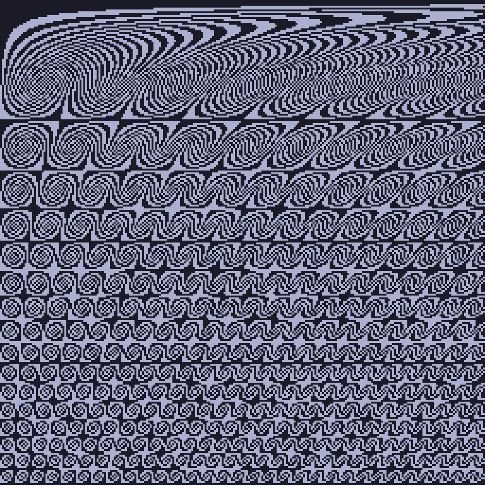

# bitcarpet
Image generator from logical expressions that uses Netpbm format.

Inspired by The Art of Computer Programming 7.1.3 Fig. 11.


Result for (y²x >> 11) & 1

# Converting Netpbm to PNG
## ImageMagick
```
magick input.ppm output.png
```

```
magick input.pbm output.png
```

## Netpbm
```
pnmtopng input.ppm > output.png
```

```
pnmtopng input.pbm > output.png
```
